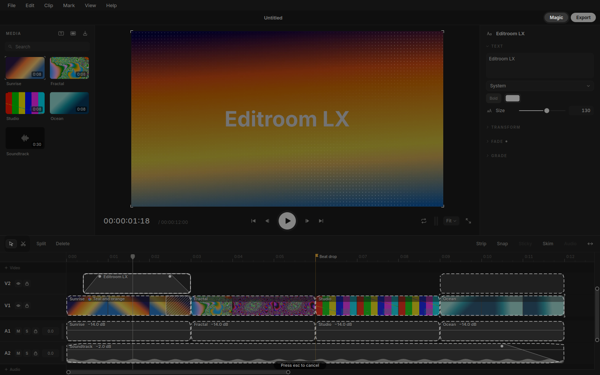
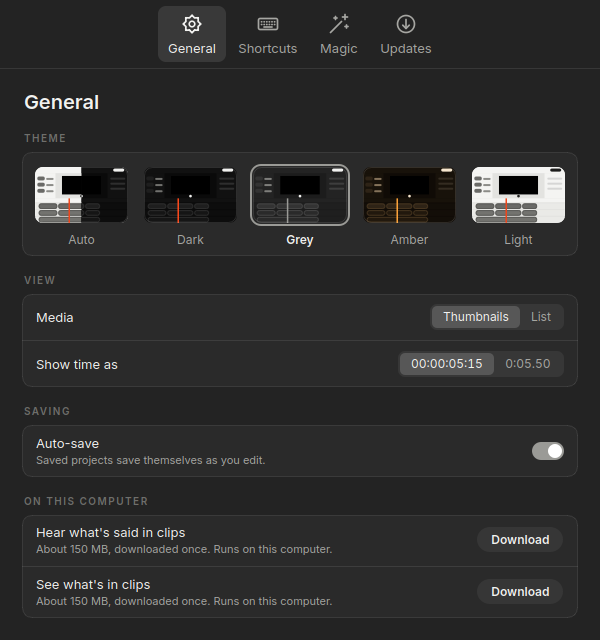
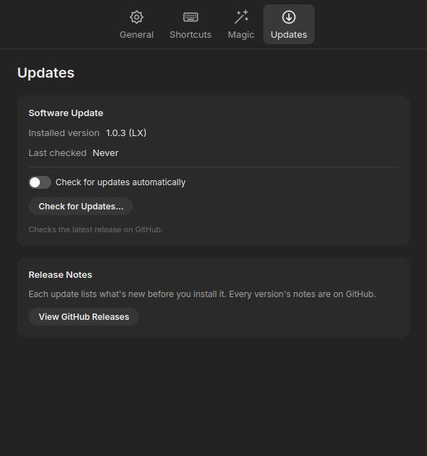

<p align="center"></p>

<h1 align="center">Editroom LX</h1>

<p align="center">A fast video editor for Linux, the port of Editroom for the Mac.<br>
C++20, Qt 6 and Vulkan. GPU where it helps, everything on your computer.</p>


## What it does

### Edit on a timeline

Bring in videos, photos and sound from anywhere: linked folders, drag and drop, or the Media panel. Hover over a
clip in Media to skim it in the viewer. On the timeline you can trim, split, move with the linked sound following,
copy with Alt, and use snapping, markers, an in/out range, fades, gain lines, dissolves and speed ramps. Every
change is one undo step.


- **Titles and captions.** Titles in any font, size and colour, with fades. Captions come from what's said in your
  clips, heard on this computer.
- **Colour.** Built-in looks (Teal and orange, Film print, Mono and others), exposure, contrast, saturation and
  three grade wheels. HDR (HLG and PQ) and Apple Log footage is brought to Rec.709.
- **Sound.** Waveforms, per-track meters and solo, ducking under dialogue, loudness targets (-14 LUFS for YouTube,
  -16 for podcasts, -23 for broadcast) and time-stretched speed changes.

### Magic

Ask for an edit in plain words, or leave the box empty for the best cut Editroom can make from your Media. It runs
through Claude Code or Codex (ChatGPT), or **Local**, which works on this computer with no account and no network.
Point at things with `@`: the playhead, the selection, the in/out range, a file, a clip or a marker.


While Magic works out the edit, the window dims and the clips it looks at are scanned. The cut it's planning is
sketched on the timeline:



Then cursors make the edit, one step at a time. The whole edit is a single undo step, and Esc puts everything back:


Local Magic can make a cut to the beat of a song, improve the edit you have, change the length, pace, look, music
and frame shape (vertical, square), add titles and captions, cut the pauses out of talking, ramp the speed and
move shots by name. AI apps connected over MCP can edit as well: 43 tools on 127.0.0.1, plus a stdio bridge.

### On your computer

- **Speech** (whisper.cpp) for captions, transcripts and searching what's said, and **scenes** (CLIP) for finding
  "the pool" or "the dog" in Media. Each model is about 150 MB and downloads once, only when you ask for it.
- **Faces** (YuNet) for picking the best moments. This model is small and comes with the app.
- Nothing you edit is sent anywhere unless you use Claude or ChatGPT, or ask for a model download or an update
  check.



### Fast

- **Rendering** runs on the GPU, through one Vulkan compositor kernel, with an OpenMP CPU path that gives the same
  pixels. A 4K frame with three layers, a grade and a title takes about 16 ms on an Intel Iris Xe.
- **Decoding** is done in hardware (VA-API, Vulkan Video, NVDEC). VA-API frames go to the compositor as
  DMA-BUFs and never pass through system memory: 4K 10-bit HEVC decodes at about 265 fps.
- **The viewer** shows frames straight from the GPU, through a Vulkan swapchain, on X11 and Wayland.

### Export

MP4 in H.264 or HEVC through hardware encoders (VA-API, NVENC, Vulkan), checked for correct colour before they're
used. Falls back to libx264 or libopenh264, and also writes WAV. Vertical, square and portrait crops, loudness
targets, the in/out range only, and a queue that runs in the background.


### Settings and updates

Five themes (Grey is the default), editable shortcuts, Magic and its AI apps, and updates. **Help › Check for
Updates…** looks for the latest release on
[GitHub](https://github.com/ClaudiuJitea/editroomLX/releases). Automatic checks are off until you turn them on,
and then run at most once a day.



Projects are `.room` files, the same format as the Mac app, so a project opens on either.

## Install

Build the packages yourself (see below), or download one from the
[releases](https://github.com/ClaudiuJitea/editroomLX/releases) when they're published:

```bash
sudo apt install ./editroom-lx_*.deb        # Ubuntu, Debian
```

For hardware video on Intel, install `intel-media-va-driver`. ONNX Runtime (`libonnxruntime1.23`) is only needed
for scene tags.

## Build

```bash
cmake --preset release && cmake --build --preset release
build/release/src/app/editroom-lx                        # the editor
cmake --build build/release --target package             # .deb and .tgz
scripts/make-appimage.sh <folder with linuxdeploy>       # AppImage (FFmpeg from the system)
```

On Ubuntu or Debian:

```bash
sudo apt install cmake ninja-build g++ qt6-base-dev glslang-tools libvulkan-dev \
  libavcodec62 libavformat62 libavutil60 libswscale9 libswresample6
```

Needs CMake 3.24+, Ninja, GCC 13+ or Clang 17+, Qt 6.8+ (Core, Gui, Widgets, Network, Concurrent, Test), OpenMP,
`glslangValidator` (glslang-tools) to compile the shaders, the FFmpeg 8 shared libraries (headers are in
`third_party/ffmpeg`), and a Vulkan 1.1 driver for the GPU path
(`EDITROOM_GPU=cpu` forces the CPU). On Intel Mesa, hardware video needs `ANV_DEBUG=video-decode,video-encode`,
which the app sets itself.

## Test

```bash
cmake --preset debug && cmake --build --preset debug && ctest --preset debug
scripts/make-test-clips.py --set tests/media             # clips some tests use
build/release/src/app/editroom-lx --selftest tests/media /tmp/st              # the headless engine check
build/release/src/app/editroom-lx --format-check /tmp/fc tests/media/*_h*.m*   # colour through every path
build/release/src/app/editroom-lx --bench bench-media    # timings
QT_QPA_PLATFORM=wayland build/debug/tests/tst_present    # GPU presenting (needs a display)
scripts/make-readme-shots.sh                             # the screenshots above
```

Tests that hear speech or see scenes need the models. Configure with `EDITROOM_WHISPER_MODEL=<ggml-base.bin>` and
`EDITROOM_CLIP_MODEL=<folder with Xenova/clip-vit-base-patch32's quantised ONNX files and tokenizer.json>`; without
them those tests skip.

## More

[PROMPT.md](PROMPT.md) sets the goals and [IMPLEMENTATION.md](IMPLEMENTATION.md) the plan.
[docs/PARITY.md](docs/PARITY.md) lists every difference from the Mac app and what's still to build. `docs/sync/`
holds one record per sync with the Mac, and `docs/bench/` the measured timings.

Editroom LX is MIT-licensed. FFmpeg is linked dynamically (LGPL); the third-party licences are in `third_party/`.
