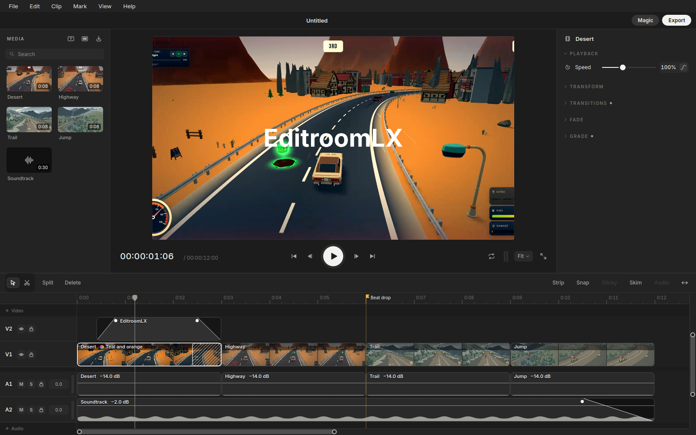
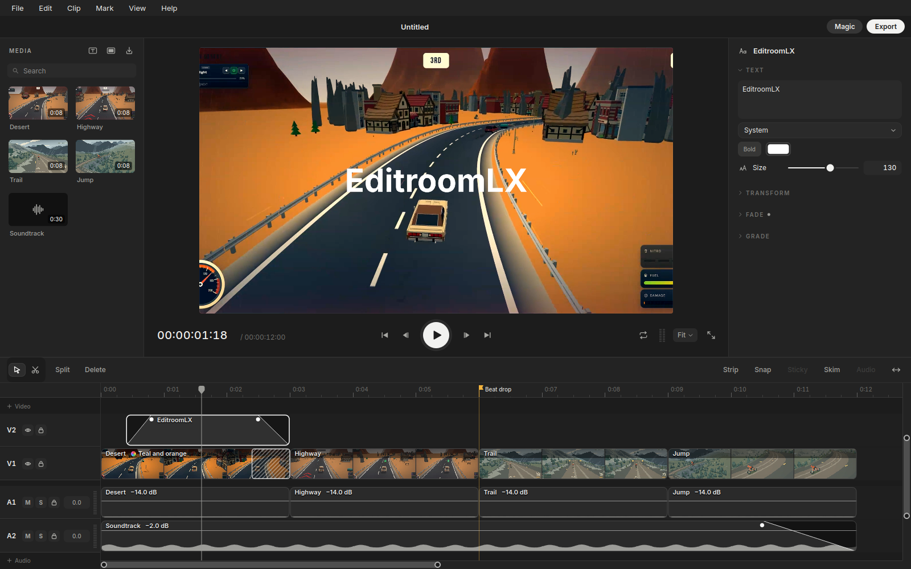
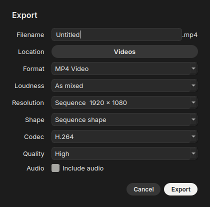
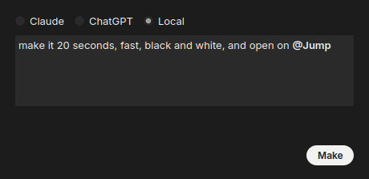
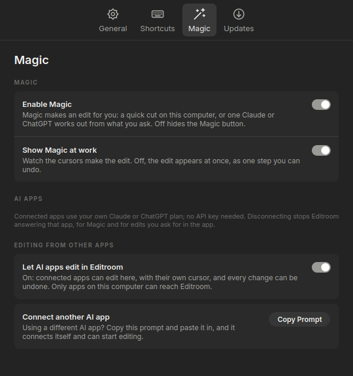

<p align="center"></p>

<h1 align="center">EditroomLX</h1>

<p align="center">A fast video editor for Linux, the port of Editroom for the Mac.<br>
C++20, Qt 6 and Vulkan. GPU where it helps, everything on your computer.</p>

<p align="center">
  <a href="https://github.com/ClaudiuJitea/editroomLX/releases">Download</a> ·
  <a href="#build">Build</a> ·
  <a href="docs/PARITY.md">Parity with the Mac</a>
</p>



## Features

| | |
|:--|:--|
| **Timeline.** Trim, split, move with linked sound, Alt-copy, snapping, markers, in/out, fades, gain lines, dissolves, speed ramps and zooms. Skim clips in Media by hovering. Every change is one undo step. | **Titles and captions.** Any font, size and colour, with fades. Captions come from what's said in your clips, heard on this computer. |
| **Colour.** Looks (Teal and orange, Film print, Mono…), exposure, contrast, saturation and three grade wheels. HDR (HLG, PQ) and Apple Log brought to Rec.709. | **Sound.** Waveforms, per-track meters and solo, ducking under dialogue, loudness targets (-14 / -16 / -23 LUFS), time-stretched speed changes. |
| **Fast.** One Vulkan compositor kernel (with an identical OpenMP CPU path): a 4K frame with three layers, a grade and a title in ~16 ms on Iris Xe. Hardware decode (VA-API, Vulkan Video, NVDEC) with zero-copy DMA-BUFs: 4K 10-bit HEVC at ~265 fps. | **Export.** H.264 or HEVC through hardware encoders (VA-API, NVENC, Vulkan), FSR 1 EASU upscaling, libx264/libopenh264 fallback, WAV, vertical and square crops, and a background queue. |

<table>
  <tr>
    <td width="50%"><br><sub>Titles, with their own inspector</sub></td>
    <td width="50%"><br><sub>Export</sub></td>
  </tr>
</table>

## Magic

Ask for an edit in plain words, or leave the box empty for the best cut EditroomLX can make from your Media. Point at
things with `@` (the playhead, the selection, a clip, a marker). It runs through Claude Code, Codex (ChatGPT) or
**Local**, which needs no account and no network. Local Magic cuts to the beat, changes length, pace, look, music and
frame shape, adds titles and captions, cuts pauses out of talking and ramps speed. Other AI apps can edit over MCP
(43 tools on 127.0.0.1, plus a stdio bridge).

<table>
  <tr>
    <td width="33%"><br><sub>Ask</sub></td>
    <td width="33%"><br><sub>It scans and sketches the cut</sub></td>
    <td width="33%"><br><sub>Cursors make it, one undo step</sub></td>
  </tr>
</table>

## On your computer, and the options

Speech (whisper.cpp) for captions and transcript search, scenes (CLIP) for finding "the dog" in Media, and faces
(YuNet) for the best moments. The speech and scene models are about 150 MB each and download only when you ask.
Nothing you edit leaves the machine unless you use Claude or ChatGPT. Settings has five themes, editable shortcuts,
Magic's AI apps and opt-in update checks (at most once a day). Projects are `.room` files, shared with the Mac app.

<table>
  <tr>
    <td width="33%"><br><sub>General: themes, saving, models</sub></td>
    <td width="33%"><br><sub>Magic and its AI apps</sub></td>
    <td width="33%"><br><sub>Updates</sub></td>
  </tr>
</table>

## Install

```bash
sudo apt install ./editroom-lx_*.deb        # from the releases, or build one below
```

For hardware video on Intel, install `intel-media-va-driver`. ONNX Runtime (`libonnxruntime1.23`) is only needed for
scene tags.

## Build

```bash
sudo apt install cmake ninja-build g++ qt6-base-dev glslang-tools libvulkan-dev \
  libavcodec62 libavformat62 libavutil60 libswscale9 libswresample6
cmake --preset release && cmake --build --preset release
build/release/src/app/editroom-lx                        # run it
cmake --build build/release --target package             # .deb and .tgz
scripts/make-appimage.sh "$PWD/build/tools"             # AppImage
```

Needs CMake 3.24+, GCC 13+ or Clang 17+, Qt 6.8+, OpenMP, the FFmpeg 8 shared libraries and a Vulkan 1.1 driver
(`EDITROOM_GPU=cpu` forces the CPU path).

<details>
<summary><b>Tests</b></summary>

```bash
cmake --preset debug && cmake --build --preset debug && ctest --preset debug
scripts/make-test-clips.py --set tests/media             # clips some tests use
build/release/src/app/editroom-lx --selftest tests/media /tmp/st              # headless engine check
build/release/src/app/editroom-lx --format-check /tmp/fc tests/media/*_h*.m*   # colour through every path
build/release/src/app/editroom-lx --bench bench-media    # timings
QT_QPA_PLATFORM=wayland build/debug/tests/tst_present    # GPU presenting (needs a display)
scripts/make-readme-shots.sh [rec-1.mp4 rec-2.mp4]       # the screenshots above
```

Speech and scene tests need `EDITROOM_WHISPER_MODEL=<ggml-base.bin>` and `EDITROOM_CLIP_MODEL=<folder with
Xenova/clip-vit-base-patch32's quantised ONNX files and tokenizer.json>`; without them they skip.
</details>

## More

[PROMPT.md](PROMPT.md) sets the goals, [IMPLEMENTATION.md](IMPLEMENTATION.md) the plan, and
[docs/PARITY.md](docs/PARITY.md) lists every difference from the Mac app. `docs/sync/` has one record per sync with
the Mac, and `docs/bench/` the measured timings.

EditroomLX is MIT-licensed. FFmpeg is linked dynamically (LGPL); the third-party licences are in `third_party/`.

## Credits

A port of [Editroom](https://github.com/robbietilton/Editroom), the open-source Mac video editor by
[@robbietilton](https://github.com/robbietilton) (Wonder Assembly LLC), MIT-licensed. Its design, features, Magic
and the `.room` format come from the Mac app. Thank you to the Editroom authors for making it open source.

Also built with [Qt](https://www.qt.io), [FFmpeg](https://ffmpeg.org), [whisper.cpp](https://github.com/ggml-org/whisper.cpp),
[ONNX Runtime](https://onnxruntime.ai), [miniaudio](https://miniaud.io),
[Signalsmith Stretch](https://signalsmith-audio.co.uk/code/stretch/), [YuNet](https://github.com/opencv/opencv_zoo)
and the [Inter](https://rsms.me/inter/) typeface.
